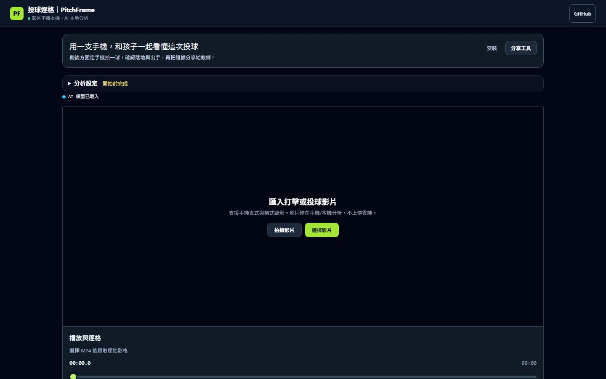

# PitchFrame ⚾

[](https://github.com/bddgtw-tw/pitchframe-baseball-lab/actions/workflows/verify.yml)

> 把一段投球影片，變成家長、球員與教練可以一起討論的逐格證據。

[立即使用 PitchFrame](https://bddgtw-tw.github.io/pitchframe-baseball-lab/) ・ [回報問題](https://github.com/bddgtw-tw/pitchframe-baseball-lab/issues)



PitchFrame 是一個免費、免登入、可離線使用的少棒投球觀察 PWA。影片在瀏覽器本機分析，不會上傳到伺服器。你可以逐格播放、疊加姿態骨架與關節角度、觀察前腳落地附近的髖肩分離趨勢，再匯出畫面、分析影片或一份可交給 AI／教練討論的結構化分析包。

如果這個工具幫你和孩子進行了一次更具體的動作討論，歡迎在 GitHub 按下 **Star**。Star 會讓更多少棒家庭找到它，也讓我們知道值得繼續維護。

## 它真正解決什麼

手機錄影常停在「看起來哪裡怪怪的」。PitchFrame 把觀察流程固定下來：

1. 用同一角度拍攝 5–10 秒，保留完整身體與出手。
2. 逐格確認前腳落地與出手，而不是只看正常速度播放。
3. 用骨架、角度和手動標註指出具體影格。
4. 匯出證據交給教練或 AI，要求建議引用時間點並標示不確定性。
5. 練習後用相同角度重拍，和球員自己的上一次比較。

PitchFrame 的價值不是自動打分，而是讓「觀察 → 建議 → 練習 → 重拍驗證」可以重複。

## 主要功能

- 真實 MP4 影格索引與 ±1／±5 格操作，支援可變幀率來源的保守處理。
- MediaPipe Pose 本機推論；沒有辨識到人物時不捏造骨架。
- 多人畫面可點選要追蹤的球員。
- 關節角度、軀幹傾角、前腳落地與出手事件估計。
- 髖肩分離趨勢視覺化，並清楚標示單機位 AI 的限制。
- 畫線、箭頭、圈選與文字註記。
- 匯出目前 PNG、骨架分析影片、AI 教練分析包（Markdown + JSON）。
- PWA 安裝與離線使用；模型與程式可快取，使用者影片不進快取。

## 家長快速開始

### 拍攝

- 手機固定，優先使用側後方視角。
- 全身、雙腳、投手丘／地面與出手位置都要留在畫面內。
- 光線充足，避免逆光、寬鬆衣物遮住肩髖與嚴重動態模糊。
- 每次盡量使用相同位置、方向與距離，才有比較價值。

### 分析

1. 開啟網站，選擇或拍攝影片。
2. 點一下要分析的球員；畫面只有一人時可直接選整張畫面。
3. 等待分析完成，先人工確認「前腳落地」是否正確；不正確就逐格定位後手動標記。
4. 輸出落地前一格、落地格、出手格的 PNG，或下載 AI 教練分析包。

### 安裝到手機

- iPhone Safari：分享 →「加入主畫面」。
- Android Chrome：選單 →「安裝應用程式」或「加到主畫面」。

首次使用需要從本站載入約 24 MB 的模型與程式。成功載入後，程式與模型會保留在裝置快取中，球場沒有網路也可使用。

## 科學與安全界線

投球是由下肢、骨盆、軀幹、上肢到球的連續動作。研究常用前腳落地、最大肩外旋與出手等事件描述動作，也會觀察骨盆與上軀幹的旋轉差和先後順序。PitchFrame 把這些概念轉成容易回看的影格與趨勢，但它仍有明確限制：

- 單一相機的 2D 投影與 AI 深度估計，不等於實驗室 3D 動作捕捉。
- 相機角度、遮擋、衣物、影格率與模糊都會改變估計結果。
- 門檻用來穩定視覺呈現，不是適用所有年齡的「標準答案」。
- 髖肩分離不是越大越好，也不能單獨代表球速、效率或受傷風險。
- 本工具不能診斷傷害或預測受傷。若有疼痛、疲勞、速度／準度突然下降或動作控制改變，應停止投球並尋求教練與醫療專業意見。

參考閱讀：

- [Baseball Pitching Biomechanics in Relation to Injury Risk and Performance](https://pmc.ncbi.nlm.nih.gov/articles/PMC3445126/)
- [Hip Flexibility and Pitching Biomechanics in Adolescent Baseball Pitchers](https://pmc.ncbi.nlm.nih.gov/articles/PMC9528701/)
- [Kinematic Parameters Predictive of Pitch Velocity: Systematic Review](https://pmc.ncbi.nlm.nih.gov/articles/PMC10687953/)
- [ASMI Position Statement for Adolescent Baseball Pitchers](https://asmi.org/position-statement-for-adolescent-baseball-pitchers/)

## 隱私

- 影片透過 `blob:` URL 由瀏覽器本機讀取，沒有影片上傳端點。
- Service Worker 只快取本站程式、模型與圖示，不攔截或保存使用者影片。
- AI 教練分析包不含原始影片，也不會自動傳給任何 AI 服務。
- GitHub Pages 仍可能接收一般網頁請求與連線資訊；本機分析不代表完全匿名。

## 開發與驗證

本專案是無建置步驟的靜態網站。所有 runtime assets 都在 repo 根目錄並使用相對路徑；`file://` 不支援，請用本機 HTTP server：

```bash
python -m http.server 8080
```

然後開啟 `http://localhost:8080/`。提交變更前至少確認：

```bash
node scripts/verify.mjs
```

- 首次載入與離線重開可用。
- iPhone／Android 直式與橫式版面可操作。
- 選片、選人、逐格、手動落地點、三種匯出皆可用。
- 沒有人物、遮擋或低可信度時不產生虛構結論。
- 瀏覽器 console 沒有新增錯誤。

## Roadmap

- 同一球員、同一機位的兩次影片比較。
- 關鍵事件卡：前腳落地、最大肩外旋代理點、出手、跟隨動作。
- 可選擇慣用手、年齡層與拍攝視角，讓 AI 分析包更完整。
- 在不離開裝置的前提下，產生多次投球的一致性報告。
- 建立可重現的測試影片與事件標記資料集，持續驗證自動偵測。

歡迎用 [Issues](https://github.com/bddgtw-tw/pitchframe-baseball-lab/issues) 提供可重現案例。請勿上傳含兒童身分資訊或未取得同意的影片；描述瀏覽器、手機型號、拍攝方向、預期與實際結果即可。

## Third-party components

- MediaPipe Pose `0.5.1675469404`，Apache 2.0；見 `pose-LICENSE-Apache-2.0.txt`。
- Tailwind CSS browser runtime `3.4.17`；見 `tailwind-LICENSE.txt`。

目前 repo 尚未宣告整體專案授權。第三方元件仍依各自授權使用；若要重用本專案程式，請先向維護者確認。
