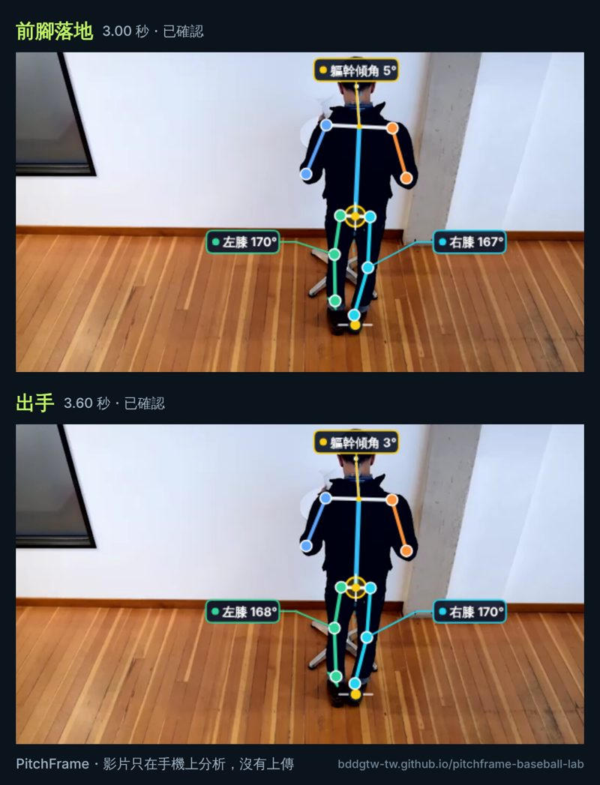

# PitchFrame ⚾

[](https://github.com/bddgtw-tw/pitchframe-baseball-lab/actions/workflows/verify.yml)

**拍一球，看懂孩子的投球。** 手機拍下孩子投球，PitchFrame 自動畫出骨架、找出前腳落地與出手，再做成一張圖讓你傳給教練。免費、免登入，影片不會上傳。

### 👉 [立即使用（手機打開就能用）](https://bddgtw-tw.github.io/pitchframe-baseball-lab/)

<p align="center">
  
</p>

<sub>示範畫面使用公開授權的測試影片。</sub>

## 三步驟

| | 你要做的事 | PitchFrame 做的事 |
|---|---|---|
| **1. 拍攝** | 手機固定在投手側面或側後方，全身入鏡，拍一球（5–10 秒）。 | 影片只在你的手機上讀取，不上傳。 |
| **2. 分析** | 在畫面上點一下你的孩子。 | 逐格畫出骨架與關節角度，自動找出前腳落地與出手。 |
| **3. 結果** | 點「前腳落地」「出手」跳過去看；不對就逐格後按「改成目前這格」。 | 按「分享結果圖給教練」，把兩個關鍵格並排成一張圖，用 LINE 等 App 傳出。 |

<p align="center">
  
</p>

## 為什麼家長會想用

- **不用猜「哪裡怪怪的」**：正常速度看不出來的瞬間，用逐格和慢動作停在同一格討論。
- **教練一看就懂**：傳出去的是一張畫好骨架的圖，不是一堆數字或檔案。
- **球場邊就能用**：第一次使用會下載約 24 MB 的 AI 模型，之後沒有網路也能分析。
- **安心**：免費、免登入、沒有廣告，影片不離開手機。

如果它幫你和孩子進行了一次更具體的討論，請幫忙按一顆 ⭐ **Star**，讓更多少棒家庭找到它。

## 拍攝小提示

- 手機固定（腳架或請人拿穩），從投手的側面或側後方拍。
- 頭到腳、出手的位置都要在畫面裡；光線充足，避免逆光。
- 每次用相同位置與距離拍，前後比較才有意義。

## 這不是什麼

PitchFrame 是觀察與溝通工具，不是評分系統，也不是醫療產品。

- 手機單一角度的 2D 骨架，不等於實驗室的 3D 動作捕捉；角度只供參考，請和孩子自己的前後影片比較。
- 自動找到的落地與出手是估計，請逐格確認。
- 不能診斷或預測受傷。若孩子有疼痛、疲勞或控制力突然變差，請停止投球並尋求專業協助。

方法、限制與參考文獻請見 [科學方法與安全界線](SCIENCE.md)。

## 隱私

- 影片透過瀏覽器本機讀取（`blob:` URL），沒有任何上傳端點。
- Service Worker 只快取本站程式、模型與圖示，不保存使用者影片。
- 結果圖與 AI 文字摘要只在你按下分享時才產生，傳給誰由你決定。
- GitHub Pages 仍會收到一般的網頁連線資訊；本機分析不代表完全匿名。

## 給 AI 的文字摘要

結果頁下方的「給 AI 的文字摘要」會產生一份 Markdown，內含前腳落地與出手的時間點與來源（人工／自動）、骨架覆蓋率、限制說明，以及要求 AI 先詢問年齡、疼痛等資訊再提出建議的指示。不含原始影片。

外部工具可用 [`pitchframe-analysis-package-v2.schema.json`](schemas/pitchframe-analysis-package-v2.schema.json) 驗證其中的結構化 JSON，並參考 [匿名範例](examples/pitchframe-analysis-package-v2.example.json)。Schema 明確禁止把旋轉差訊號當成已驗證的物理量。

## 開發

無建置步驟的靜態網站：一個 `index.html`，加上同源的 MediaPipe Pose 模型檔。`file://` 無法使用，請開本機 HTTP server：

```bash
python -m http.server 8080
# 開啟 http://localhost:8080/
```

提交前執行：

```bash
node scripts/verify.mjs
node tests/events.test.cjs
```

並確認：手機直式與橫式都能完成「選片 → 點選孩子 → 逐格 → 標記落地／出手 → 分享結果圖」，console 沒有新增錯誤，`sw.js` 的 `VERSION` 已更新。

設計原則只有一條：**主流程只有拍攝、分析、結果三步。** 新增任何按鈕前，先回答它是否幫家長更快、更準地看懂這一球；答不出來就不加。詳見 [CONTRIBUTING.md](CONTRIBUTING.md) 與 [GOALS.md](GOALS.md)。

想幫忙實測？請看 [5 分鐘家長／教練實測任務](PILOT.md)。請勿公開兒童影片或可識別資訊。

## Third-party components

- MediaPipe Pose `0.5.1675469404`，Apache 2.0；見 `pose-LICENSE-Apache-2.0.txt`。

目前 repo 尚未宣告整體專案授權。第三方元件仍依各自授權使用；若要重用本專案程式，請先向維護者確認。
